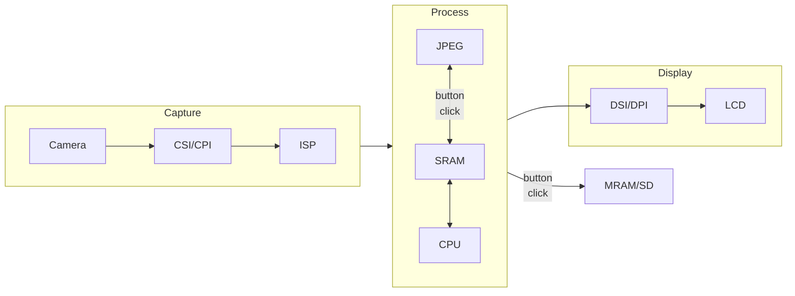
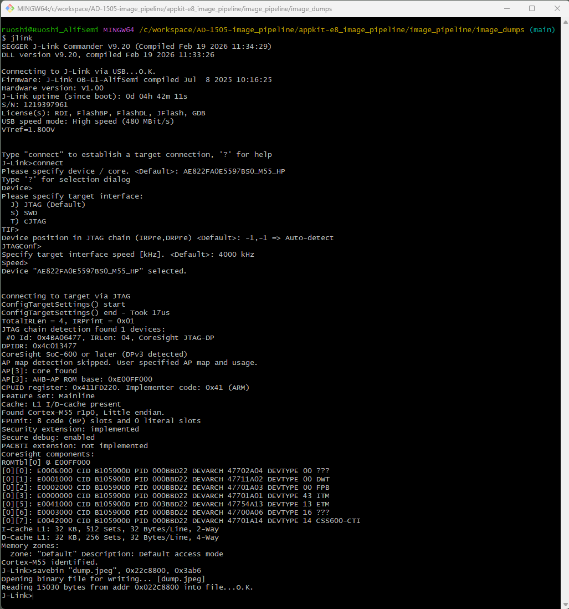

# Image Pipeline Project User Guide  
This project demonstrates the E8 image-processing pipeline, from camera capture to image processing, JPEG compression, display, and storage. The capture flow is similar to the viewfinder project, while this application emphasizes JPEG encoding and image storage.  
The project is prepared for the MT9M114 camera and the following builds. Support can be extended to the HE core.    
> AppKit-E8 HP -- image_pipeline_mram  
> DevKit-E8 HP -- image_pipeline_sd_fatfs (insert an SD card into the slot)  

When mounting the camera, use the connector on the side opposite the processor.  
Magnetoresistive RAM (MRAM) is non-volatile storage available on many Alif Semiconductor SoCs. It can be used similarly to Flash.  

## 1. Introduction  
The peripherals and data flow used in this project are summarized in the following figure.  



On the capture side, the camera sensor outputs 1280x720 RAW8 frames through CSI/CPI. After CPI (Camera Parallel Interface), the SoC can either write data directly to SRAM through AXI or route it to the ISP (Image Signal Processor). The on-chip ISP provides basic processing features such as binning, color correction, and format conversion. In this example, the ISP converts the image to YUV420SP (NV12), and the output is stored in SRAM.  
The Helium core then converts NV12 to RGB565 for LCD compatibility. Two display buffers are used for ping-pong operation: buffer A receives the latest frame while buffer B is displayed, then they swap when a full frame is ready.  
If the user button is pressed, the JPEG encoder compresses the NV12 image in SRAM and stores the result to MRAM or SD card.  
Measured JPEG performance is about 500 MPixel/s, under 4 ms per conversion, and about 15 mW average power when encoding from SRAM.  

## 2. Project Structure  
The file structure follows the [standard Alif VS Code project template](https://github.com/alifsemi/alif_vscode-template). For project setup details, see [getting_started.md](https://github.com/alifsemi/alif_vscode-template/blob/main/doc/getting_started.md).  
Important folders are listed below.  
```
/alif_image-pipeline-example
├─ board
├─ doc
├─ image_pipeline_mram
└─ image_pipeline_sd_fatfs
```
`board` contains the board support package (BSP).  
`doc` contains this user guide.  
`image_pipeline_mram` contains the MRAM-based application source code.  
`image_pipeline_sd_fatfs` contains the SD/FatFS-based application source code.  

## 3. Integration Guide  

### 3.1 Camera Capture/Interface  
The serial camera sends frame data through RX D-PHY into the CSI controller. CSI then forwards the stream to CPI (Camera Parallel Interface) through IPI (Image Pixel Interface).  

To enable camera capture, add support for CPI, CSI, DPHY, and I2C (camera control).  
Open `<build_name>.cproject.yml`, locate `components`, and add:  
```yml
- component: AlifSemiconductor::Device:SOC Peripherals:CPI
- component: AlifSemiconductor::Device:SOC Peripherals:MIPI DSI CSI2 DPHY
- component: AlifSemiconductor::Device:SOC Peripherals:MIPI CSI2
- component: AlifSemiconductor::BSP:External peripherals:CAMERA Sensor MT9M114
- component: AlifSemiconductor::CMSIS Driver:I2C
```
You can switch the camera sensor to MT9M114, ARX3A0, or OV5675. You can also create a custom camera driver by following: [Custom camera module driver howto](https://github.com/alifsemi/alif_M55-viewfinder/blob/main/doc/camera_module.md) and [Integrating new panel and sensor](https://github.com/alifsemi/alif_M55-viewfinder/blob/main/doc/integrating_new_panel_and_sensor.md).  

You can also reuse the application-level camera code. Copy the [camera](../image_pipeline_mram/camera/) folder into your application and include the source file in `<build_name>.cproject.yml`. You can add it directly under the App group (`- file: camera/camera.c`) or place it in another group shown in the CMSIS panel.  

`RTE_Device.h` contains most driver and application configuration options used at build time. In the CMSIS panel, find it under `AlifSemiconductor::Device::Startup`.  
You can open it in GUI mode (Reopen Editor With...) or edit it as text. Enable the required entries by searching: `Driver_MIPI_CSI2`, `Driver_CPI`, `Driver_MT9M114_MIPI`, and `Driver_I2C1`.  

### 3.2 Image Signal Processing (ISP)  
Using ISP is optional. For the full feature list, refer to the hardware reference manual. In this demo, ISP is used for format conversion to reduce CPU load.  
For both serial and parallel cameras, data comes out of CPI. From CPI, data can go directly to SRAM or to ISP for additional processing. ISP input is CPI only. To enable ISP:  
1. Add `- component: AlifSemiconductor::Device:SOC Peripherals:ISP` to `components` in `<build_name>.cproject.yml`.  
2. Enable `Driver_ISP` in `RTE_Device.h`. This section also lists supported output formats and dimensions.  

### 3.3 JPEG Encoder  
The JPEG encoder accesses image data through AXI memory only.  
1. The JPEG driver can be added by adding `- component: AlifSemiconductor::Device:SOC Peripherals:JPEG` to the `<build_name>.cproject.yml`.  
2. Enable `Driver_JPEG` in `RTE_Device.h`, then adjust the related settings.  

A JPEG driver usage example is available in `jpeg_app.c`.  

## 4. Image Extraction  
During execution, UART prints performance logs. Press the user button (center of SW2) at any time to trigger JPEG conversion. The image is then saved to MRAM or SD card, depending on the build.  
After completion, a J-Link command is shown to extract the image from SRAM or MRAM.    

Open J-Link in a terminal window. Type `connect`, then press Enter five times to accept defaults until `J-Link>` appears.  
Use `savebin` to dump memory. Example:  
```
savebin "dump.jpeg", 0x22c8800, 0x3ab6
```    
`0x22c8800` is the buffer address, and `0x3ab6` is the byte count.  
An example command-line session is shown below:  

  

>Note: Make sure J-Link is installed and its executable path is added to Windows environment variables.  

## 5. Display  
AppKit supports the ILI9806E LCD panel. For detailed documentation, refer to the [alif_M55-viewfinder project](https://github.com/alifsemi/alif_M55-viewfinder).  

## 6. Saving Image to MRAM  
The encoded JPEG image can be stored in on-chip MRAM and retained across power cycles. The MRAM driver is available in CMSIS DFP.  
1. Enable the MRAM driver by adding `- component: Device:SOC Peripherals:MRAM` to `<build_name>.cproject.yml`.  
2. Example MRAM code is available in `jpeg_app.c` and `main.c`.  
3. When saving to MRAM, pass an offset relative to `APP_MRAM_USER_BASE` in `app_mem-regions.h` to `MRAM_drv->ProgramData()`. This file is listed under `AlifSemiconductor::Device:Startup`.  

## 7 Saving Image to SD Card  
Use the `image_pipeline_sd_fatfs` build to store JPEG images on an SD card instead of MRAM.  

1. Insert a FAT32-formatted SD card before starting the application.  
2. Enable `AlifSemiconductor::Device:SOC Peripherals:SDMMC` in `<build_name>.cproject.yml`.  
3. Keep the FatFS sources in the project (`FatFS/diskio.c`, `ff.c`, `ffsystem.c`, and `ffunicode.c`).  
4. Press the user button (SW2 center) to capture and save one image.  

Saved files are written to the SD card root as `IMG_0001.jpeg`, `IMG_0002.jpeg`, and so on. The application scans existing files at startup and continues from the next available index.  

If saving fails, check card detect/reset wiring and verify the card can be mounted by FatFS (`f_mount`).  

## 8 Release Build  
The default configuration for both targets is `debug`. This configuration is not memory-optimized and runs from MRAM.  
For better CPU performance (for example, AIPL NV12-to-RGB565 conversion), run critical code from ITCM by switching to a `release` build.  
To enable `release`, open `linker_gnu_mram.ld.src` under the linker section in the CMSIS panel and remove the comment markers on the ITCM-related placement entries (line 90, 92, and 150).  